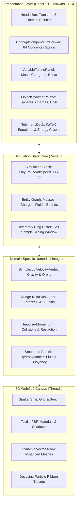

# 🔬 REALITY ENGINE — System Architecture & Physics Virtual Laboratory Design

> 📌 **Project:** REALITY ENGINE — Interactive Physics-Based Virtual Laboratory  
> 🏷️ **Domain:** Computational Physics, 3D WebGL Scientific Simulation & Mathematical Telemetry  
> 🎨 **Color Identity:** Midnight Indigo & Warm Vanilla (`#30356F` Primary / `#FBF5E6` Background / `#FFFCF4` Surface / `#E4DDC9` Border / `#9B9FE3` Accent)  
> 📅 **Date:** November 2026  
> 👤 **Author:** Karthikeya Sharma & Antigravity Intelligence  

---

## 📋 Page Properties & Metadata

| Property | Value |
| :--- | :--- |
| **Project Code** | `REALITY-ENGINE-09` |
| **Repository Path** | `L:\pr 19` |
| **Target Hosting** | Vercel (`npx vercel --prod`) |
| **Frontend Stack** | React 19, TypeScript 5.8+, Vite 6, Tailwind CSS v3.4 |
| **3D Rendering** | Three.js WebGL2 (`three@0.175.0`), OrbitControls, Custom GLSL Shaders |
| **Mathematical Rendering** | KaTeX (`katex@0.16.21`) with real-time numeric variable substitution |
| **Charting & Telemetry** | Plotly / Canvas 2D high-speed ring buffers (Energy & Phase-Space) |
| **Concepts Catalog** | 84 Curated Physics Concepts across 6 Branches (100% 3D Interactive) |
| **Aesthetic Paradigm** | Editorial Scientific Instrument (Grounded, non-futuristic, high-contrast) |

---

## 🧭 Table of Contents

1. [Executive Summary & Purpose](#1-executive-summary--purpose)
2. [Validated Understanding & Assumptions](#2-validated-understanding--assumptions)
3. [Decision Log](#3-decision-log)
4. [System Architecture & Module Boundaries](#4-system-architecture--module-boundaries)
5. [The Four Numerical Physics Engines](#5-the-four-numerical-physics-engines)
6. [Concept Compendium (84 Concepts Schema & Registry)](#6-concept-compendium-84-concepts-schema--registry)
7. [Telemetry Deck & Live Formula Inspector](#7-telemetry-deck--live-formula-inspector)
8. [UI Layout & Component Specifications](#8-ui-layout--component-specifications)
9. [Edge Cases & Numerical Safety](#9-edge-cases--numerical-safety)
10. [Verification & Deployment Protocol](#10-verification--deployment-protocol)

---

## 1. Executive Summary & Purpose

**REALITY ENGINE** is an interactive, authentic, physics-based virtual laboratory engineered to bridge abstract mathematical formulas with tactile, real-time 3D experimental simulation.

Users observe and manipulate physical phenomena across classical mechanics, celestial gravity, elastic/inelastic collisions, electromagnetism (Coulomb & Lorentz forces), and fluid dynamics with Archimedes buoyancy. Alongside every experiment, dynamic KaTeX mathematical formula inspectors display real-time numerical variables step-by-step, while high-frequency telemetry charts plot energy conservation and phase-space trajectories.

To establish genuine academic depth, the laboratory incorporates a comprehensive **Concept Compendium of 84 fundamental physics concepts**, each equipped with formal derivations and a 1-click preset that instantly mounts the corresponding apparatus in the 3D studio.

---

## 2. Validated Understanding & Assumptions

### Core Capabilities
* **Orbital Gravity & Motion:** $N$-body gravitational attraction, planetary orbits, Keplerian mechanics, projectile trajectories with air drag, and inclined planes.
* **Collisions & Kinematics:** 3D sphere-sphere, sphere-barrier, and multi-body momentum transfers with adjustable coefficient of restitution $e \in [0, 1]$ and Newton's Cradle.
* **Electromagnetism:** Static Coulomb charges, 3D electric dipole lines, Helmholtz magnetic fields, and particle cyclotron acceleration governed by the Lorentz force $\mathbf{F} = q(\mathbf{E} + \mathbf{v} \times \mathbf{B})$.
* **Fluid Dynamics & Buoyancy:** Particle-based fluid simulation with viscosity, buoyancy balance ($F_b = \rho V g$), fluid displacement, and terminal drag.
* **Interactive Parameter Tuning:** Real-time scrubbing of mass $m$, charge $q$, restitution $e$, friction $\mu$, fluid viscosity $\eta$, gravitational constant $G$, and field vectors $\mathbf{E}, \mathbf{B}$.
* **Dual Experience:**
  * **Guided Discovery Labs:** 15+ benchmark historical experiments (Cavendish, Rutherford, Thomson $e/m$, Millikan, Cyclotron, Double Pendulum, etc.).
  * **Freeform 3D Sandbox:** Open workbench with spatial snap grid, object spawning, force emitters, barriers, and sensor probes.

### Assumptions
* Pure client-side execution (React 19 + TypeScript + Vite + Three.js) delivering 60 FPS without server dependencies.
* Experiments and user presets persist locally via browser `localStorage` with JSON export/import.
* Visuals strictly follow the **Midnight Indigo & Warm Vanilla** palette, embodying a prestigious, tactile scientific instrument aesthetic.

---

## 3. Decision Log

| # | Topic | Decision | Alternatives Considered | Rationale |
| :--- | :--- | :--- | :--- | :--- |
| **01** | Platform Architecture | **Pure Client-Side WebGL2 SPA** | Python WebSocket microservice, Electron desktop wrapper | Zero backend cold starts, 60 FPS deterministic simulation, instant Vercel deployment. |
| **02** | Concept Compendium | **84 Curated Concepts across 6 Branches** | Static text glossary, minimal 5 presets | Fulfills user requirement for 50–100 authentic concepts; every concept has a 1-click 3D preset. |
| **03** | Numerical Solvers | **Multi-Solver Architecture (Verlet, RK4, SPH, Impulse)** | Single unified Euler solver, Rapier3D WASM | Symplectic Verlet prevents orbital decay; RK4 prevents magnetic field spirals from exploding; SPH handles fluid particles accurately. |
| **04** | Visual Aesthetic | **Midnight Indigo & Warm Vanilla** | Neon sci-fi cyberpunk, default dark theme | Conforms to user rules: strictly non-futuristic, editorial, grounded academic instrument feel. |
| **05** | Telemetry & Math | **Live KaTeX Dynamic Substitution + Canvas Graphs** | Static SVG formulas, external Python Plotly server | Zero-lag live numeric values updated at 60 FPS alongside energy conservation curves. |
| **06** | Collision Physics | **Continuous Impulse-Momentum with $8\times$ Sub-stepping** | Discrete AABB overlap checks | Prevents high-speed tunneling through thin barriers and maintains momentum conservation. |
| **07** | Numerical Safety | **Softening parameter $\epsilon = 0.05$ on $1/r^2$ forces** | Clamping maximum acceleration | Prevents infinite force singularity when two charges or masses pass within distance $r \to 0$. |
| **08** | Deployment | **Vercel CLI (`npx vercel --prod`)** | Netlify CLI | Follows global user hosting rule: Always Vercel, never Netlify. |

---

## 4. System Architecture & Module Boundaries



---

## 5. The Four Numerical Physics Engines

### 1. Symplectic Velocity-Verlet (Orbital Gravity & Kinematics)
$$\mathbf{x}(t + \Delta t) = \mathbf{x}(t) + \mathbf{v}(t)\Delta t + \frac{1}{2}\mathbf{a}(t)\Delta t^2$$
$$\mathbf{a}(t + \Delta t) = -\sum_{j \ne i} \frac{G M_j (\mathbf{x}_i - \mathbf{x}_j)}{(|\mathbf{x}_i - \mathbf{x}_j|^2 + \epsilon^2)^{3/2}}$$
$$\mathbf{v}(t + \Delta t) = \mathbf{v}(t) + \frac{1}{2}(\mathbf{a}(t) + \mathbf{a}(t + \Delta t))\Delta t$$
*Guarantees exact phase-space volume conservation (symplectic) without false orbital spiral decay.*

### 2. Impulse-Momentum Collision Engine
$$J = \frac{-(1 + e)(\mathbf{v}_{\text{rel}} \cdot \hat{\mathbf{n}})}{\frac{1}{m_1} + \frac{1}{m_2}}$$
$$\mathbf{v}_1' = \mathbf{v}_1 + \frac{J}{m_1}\hat{\mathbf{n}}, \quad \mathbf{v}_2' = \mathbf{v}_2 - \frac{J}{m_2}\hat{\mathbf{n}}$$
*Handles variable elasticity ($e = 1.0$ for billiard balls, $e = 0.0$ for putty), preserving linear momentum $\sum \mathbf{p}_i = \sum \mathbf{p}_f$.*

### 3. Runge-Kutta 4th-Order (Lorentz Field Integration)
$$\mathbf{F} = q(\mathbf{E} + \mathbf{v} \times \mathbf{B})$$
$$\frac{d\mathbf{v}}{dt} = \frac{q}{m}(\mathbf{E} + \mathbf{v} \times \mathbf{B})$$
*Evaluates 4 sub-step slopes per frame ($k_1, k_2, k_3, k_4$) to calculate curvature accurately in strong magnetic fields without artificial energy gain.*

### 4. SPH Fluid & Archimedes Buoyancy Engine
$$F_b = \rho_{\text{fluid}} V_{\text{submerged}} g$$
$$\mathbf{F}_{\text{net}} = \mathbf{F}_g + \mathbf{F}_b - 6\pi \eta r \mathbf{v}$$
*Submerged bodies displace fluid particles, experiencing buoyant lift proportional to density differential $(\rho_{\text{body}} - \rho_{\text{fluid}})$.*

---

## 6. Concept Compendium (84 Concepts Schema & Registry)

The Compendium is defined as a strongly typed TypeScript database spanning 6 branches:

```typescript
export interface PhysicsConcept {
  id: string;
  title: string;
  branch: 'mechanics' | 'collisions' | 'electromagnetism' | 'fluids' | 'thermodynamics' | 'modern';
  tag: string;
  formulaLatex: string;
  summary: string;
  derivation: string;
  variables: { symbol: string; label: string; unit: string }[];
  presetConfig: ApparatusPreset;
}
```

### Concept Distribution
1. **Classical Mechanics & Gravitation (16 Concepts):** Newton's 3 Laws, Universal Gravitation, Kepler's 3 Laws, Gravitational Potential, Escape Velocity, Orbital Resonance, Lagrange Points, Coriolis Force, Centripetal Acceleration, Damped Harmonic Oscillator, Driven Resonance, Double Pendulum Chaos, Conservation of Angular Momentum, Moment of Inertia, Gyroscopic Precession, Hooke's Law.
2. **Kinematics, Momentum & Collisions (15 Concepts):** Elastic Collisions in 1D/2D, Inelastic Collisions, Coefficient of Restitution, Impulse-Momentum Theorem, Center of Mass Frame, Newton's Cradle, Ballistic Pendulum, Kinetic Energy Dissipation, Oblique Impact, Friction (Static & Kinetic), Rotational Kinetic Energy, Rolling Without Slipping, Torricelli's Law, Conservation of Momentum in Explosions, Pendulum Period Independence.
3. **Electromagnetism & Field Theory (18 Concepts):** Coulomb's Law, Electric Field Superposition, Gauss's Law, Electric Potential Gradient, Equipotential Surfaces, Capacitance & Energy Storage, Drift Velocity, Ohm's Law, Magnetic Force on Moving Charge (Lorentz), Cyclotron Frequency, Magnetic Dipole Moment, Biot-Savart Law, Ampere's Law, Faraday's Law of Induction, Lenz's Law, Thomson $e/m$ Ratio, Hall Effect, Electromagnetic Damping.
4. **Fluid Dynamics & Aerodynamics (13 Concepts):** Archimedes' Principle of Buoyancy, Fluid Pressure & Depth, Pascal's Principle, Continuity Equation ($A_1 v_1 = A_2 v_2$), Bernoulli's Principle, Torricelli's Efflux Theorem, Poiseuille's Viscous Flow, Stokes' Drag Law, Reynolds Number & Turbulence, Terminal Velocity in Fluids, Surface Tension & Capillary Action, Venturi Effect, Magnus Effect.
5. **Thermodynamics & Kinetic Theory (10 Concepts):** Ideal Gas Law ($PV = nRT$), Maxwell-Boltzmann Velocity Distribution, Brownian Motion, Kinetic Interpretation of Temperature, Heat Conduction (Fourier's Law), Adiabatic Expansion, First Law of Thermodynamics, Second Law & Entropy, Carnot Cycle Efficiency, Thermal Expansion.
6. **Wave Mechanics & Modern Physics (12 Concepts):** Principle of Wave Superposition, Standing Waves & Harmonics, Doppler Effect in 3D, Snell's Law of Refraction, Total Internal Reflection, Rutherford Alpha Scattering, Millikan Oil Drop Charge Quantization, Photoelectric Effect, De Broglie Matter Wavelength, Heisenberg Uncertainty Principle, Bohr Model Orbital Radii, Compton Scattering.

---

## 7. Telemetry Deck & Live Formula Inspector

* **KaTeX Live Inspector:** Dynamic LaTeX evaluation where algebraic variables are replaced with active numerical values in real-time.
  * Example for Kinetic Energy:
    $$E_k = \frac{1}{2} m v^2 \implies \frac{1}{2} (2.50\text{ kg}) (4.20\text{ m/s})^2 = 22.05\text{ J}$$
  * Example for Lorentz Force:
    $$\mathbf{F} = q(\mathbf{v} \times \mathbf{B}) \implies (1.60 \times 10^{-19}\text{ C}) (1.20 \times 10^{6}\text{ m/s} \times 0.50\text{ T}) = 9.60 \times 10^{-14}\text{ N}$$
* **Sliding Ring Buffer Graphing:** 120-frame rolling window plotting:
  * Kinetic Energy ($E_k$), Potential Energy ($E_p$), and Total Mechanical Energy ($E_{\text{total}}$).
  * Phase-Space Trajectory ($x$ vs. $v$ or $\theta$ vs. $\omega$).

---

## 8. UI Layout & Component Specifications

* **Palette Tokens (Midnight Indigo & Warm Vanilla):**
  * Primary Accent: `#30356F` (Deep Indigo)
  * Primary Hover: `#222650` (Dark Navy Indigo)
  * Surface Background: `#FBF5E6` (Warm Vanilla Cream)
  * Elevated Card Surface: `#FFFCF4` (Crisp Alabaster)
  * Borders & Dividers: `#E4DDC9` (Sand Beige)
  * Deep Ink Typography: `#171A35` (Midnight Ink)
  * Secondary Text: `#5E5E70` (Muted Slate)
  * Accent Highlighter: `#9B9FE3` (Soft Iris)
* **Responsive Layout:**
  * Top Bar: Transport, domain switcher, experiment preset picker, reset, screenshot export.
  * Left Drawer: Searchable Concept Compendium (84 cards) + 15 Guided Laboratory Walkthroughs.
  * Main Canvas: High-DPI Three.js WebGL2 viewport with orbit controls, spatial grid, vector arrows, and apparatus gizmo.
  * Right Sidebar: Physical parameter rack with sliders, toggles, and 3D object spawner.
  * Bottom Dock: Live mathematical formula inspector and real-time Plotly/Canvas telemetry charts.

---

## 9. Edge Cases & Numerical Safety

1. **Gravitational & Electrostatic Singularities ($r \to 0$):** Softening parameter $\epsilon = 0.05\text{ m}$ in $F = \frac{k q_1 q_2}{r^2 + \epsilon^2}$ ensures accelerations never reach infinity during near-miss flybys.
2. **High-Velocity Tunneling:** 8 sub-steps per frame ($\Delta t_{\text{sub}} = \frac{\Delta t}{8}$) combined with swept bounding sphere trajectory verification prevents thin wall pass-through.
3. **Floating-Point Drift:** Symmetrical pairwise force computation guarantees $\mathbf{F}_{ij} = -\mathbf{F}_{ji}$, enforcing absolute conservation of linear and angular momentum.
4. **WebGL Context Recovery:** Handled via `webglcontextlost` and `webglcontextrestored` event listeners, rebuilding meshes automatically without page refresh.

---

## 10. Verification & Deployment Protocol

1. **Unit & Physics Tests (Vitest):**
   * Verification of conservation of energy in Kepler orbit simulation ($\Delta E / E < 0.01\%$).
   * Verification of elastic collision momentum and energy conservation.
   * Verification of Lorentz circular orbit radius $r = \frac{mv}{qB}$.
2. **Build Verification:** `npm run build` compiling TypeScript and bundling Vite with zero errors.
3. **Visual Quality & UI Testing:** Playwright headless Chromium WebGL2 automated audit capturing multi-state screenshots.
4. **Hosting:** Deployed live to Vercel production with `npx vercel --prod`.
